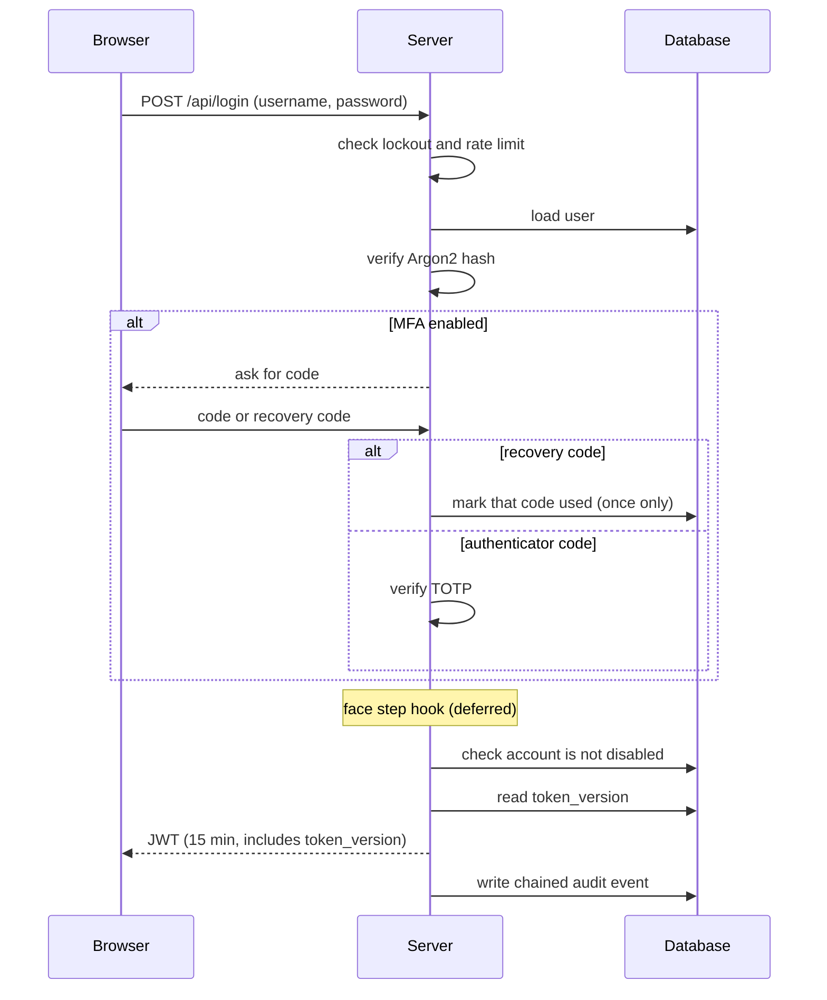

# SecureVault: Architecture

## Component diagram

```mermaid
flowchart LR
    U[User browser<br/>HTML + CSS + JS<br/>no frameworks] -->|JSON over HTTP(S)<br/>Bearer JWT| API

    subgraph Server[Flask application]
        API[Request layer<br/>size cap, security headers,<br/>error handler]
        API --> RL[Rate limiter<br/>lockout, DB-backed]
        API --> AUTH[Auth<br/>Argon2, TOTP MFA + recovery codes,<br/>JWT, password reset, password policy]
        API --> VAULT[Vault<br/>images, cards]
        API --> MSG[Messages<br/>user-to-user, AES-256-GCM]
        U -->|offline, client-side only| CHAT[Encryption FAQ<br/>static answers, no server call]
        API --> ADM[Admin<br/>logs + chain verify, users,<br/>disable/unlock, stats]
        VAULT --> UK[Per-user data keys<br/>wrapped by the master key]
        UK --> CR[Crypto<br/>AES-256-GCM]
        VAULT --> CR
        MSG --> CR
        AUTH --> AUD[Audit log<br/>hash-chained]
        VAULT --> AUD
        MSG --> AUD
        ADM --> AUD
    end

    CR -. loads keys .-> KEYS[(.secrets/<br/>vault_key, jwt_secret)]
    AUTH --> DB[(SQLite<br/>users, ciphertext,<br/>chained audit log)]
    VAULT --> DB
    MSG --> DB
    VAULT --> FS[(uploads/<br/>encrypted .bin files)]
    AUD --> DB
```

## Login flow



## New since the first build

| Feature | What it adds |
|---|---|
| Password policy | Length-first rule (NIST SP 800-63B) plus a common-password blocklist, checked on sign-up, change, and reset |
| MFA recovery codes | 8 single-use backup codes issued when MFA is turned on; log in with one instead of the authenticator app; regenerable with the current password |
| Admin disable / unlock | An admin can disable an account (blocks login, ends open sessions immediately) or clear a lockout, without touching the password |
| Tamper-evident audit log | Each row is hash-chained to the one before it; `GET /api/admin/logs/verify` recomputes the chain and reports the first row that does not match |
| Per-user data keys | Every account's images and cards are encrypted with that account's own key (wrapped by the server master key), not a key shared by everyone; a key can be rotated from the account screen |
| My activity | A signed-in user can see their own recent audit events (not just admins) |
| Idle auto-logout | The browser session ends after 5 minutes of no activity, shorter than the 15-minute token lifetime |
| Encryption chat | A built-in, fully offline FAQ chat (pinned entry in the leftmost Vault tab) answers canned questions about the encryption techniques this project actually uses - no external API, no network call |
| User-to-user messages | Any signed-in account can message any other active account; each body is AES-256-GCM encrypted server-side, bound to the conversation pair and message id, send-rate limited, and the recent-message list polls for new ones every few seconds |

## Data protection at a glance

| Data | How it is stored |
|---|---|
| Password | Argon2 hash |
| MFA secret | Stored for the user, never returned after setup |
| MFA recovery codes | SHA-256 hash only; the plaintext code is shown once and never stored |
| Images | Encrypted bytes in a randomly named `.bin` file, keyed by the owner's own data key |
| Cards | Encrypted number, holder and expiry; token and last four digits; no CVV |
| Messages | AES-256-GCM, server master key, associated data bound to the conversation pair and the message's own id; not end-to-end |
| Per-user data keys | Wrapped (encrypted) by the server master key; versioned so a rotation never breaks old data |
| Keys | Files in `.secrets/`, outside the database and outside Git |
| Sessions | JWT, 15 minutes, invalidated by `token_version`; also ended by 5 minutes of browser inactivity |
| Audit log | Hash-chained: each row's hash covers its own fields plus the previous row's hash |

## Folder map

```
app/
  auth/       passwords, tokens, mfa + recovery codes, routes, password reset
  vault/      images, cards
  chat/       messages.py - user-to-user AES-256-GCM messaging
  admin/      logs + chain verify, users (+ disable/unlock), stats
  crypto/     keys, aes, userkeys (per-user data keys)
  security/   ratelimit (DB-backed), audit (hash-chained), password_policy, mailer
  pagination.py   shared ?limit=&offset= parsing for list endpoints
static/, templates/   frontend (Chat tab: offline FAQ bot + real user-to-user messaging)
tests/                threat-model, hardening and smoke tests, plus one file per
                      new feature (password policy, recovery codes, admin user
                      management, audit chain, user keys, activity, messages)
scripts/              hardening_check, scan_git_history, check_face_setup
docs/                 report, threat model, architecture, demo script
serve.py              production server (Waitress)
```
